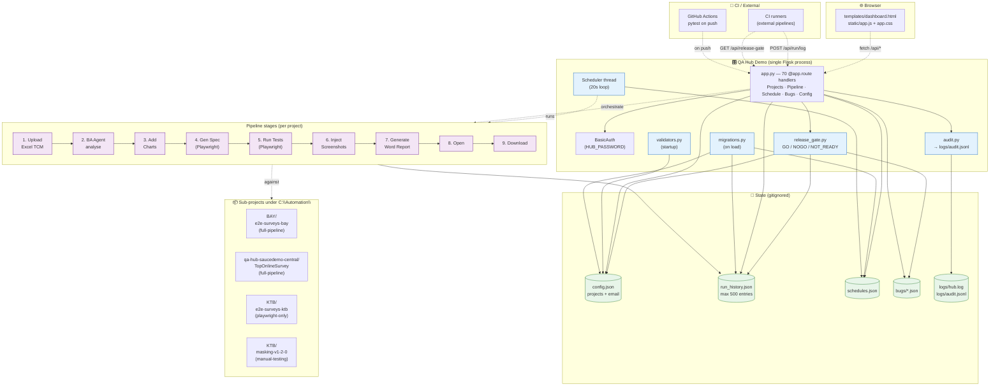

# QA Hub Demo — Central Multi-Project Dashboard

Single Flask app (`app.py`) ที่รันครั้งเดียวแล้วจัดการทุก project ใน `C:\Automation\`

## Architecture



**Reading the diagram:**
- Solid arrows = synchronous call / data flow. Dotted = external / async / on-event.
- Hub is **stateless** in itself — all persistence lives in `State` (JSON files). Restart the process, state survives.
- Every `/api/*` route first goes through `BasicAuth` (if `HUB_PASSWORD` is set), then reads/writes one or more of the State files.
- `Scheduler` is a background thread inside the same process — not a separate service. It polls `schedules.json` every 20s and fires pipeline runs.
- Sub-projects are **regular folders** on disk. Hub only needs their `path` + `type`; it doesn't manage them beyond that.

## เริ่มใช้งาน
```bash
cd C:\Automation\_hub
python app.py          # เปิด http://localhost:8080
```

## โครงสร้าง
```
C:\Automation\
  _hub/
    app.py                    — Flask server + API routes
    release_gate.py           — release gate domain logic
    migrations.py             — schema migration hooks
    validators.py             — config.json startup validation
    templates/
      dashboard.html          — HTML shell
      alpine_demo.html        — Alpine.js PoC (/alpine-demo)
    static/
      app.css                 — dashboard styles
      app.js                  — dashboard JS (section-marked)
    config.json               — รายชื่อ projects ที่ register ไว้
    run_history.json          — ประวัติการรัน tests ทุก project
    schedules.json            — scheduled runs (id, project, action, tag, env, time)
    schedule.log              — log ทุก event ของ scheduler (max 500 lines)
    bugs/                     — bug reports แยกไฟล์ต่อ project (<project_id>.json)
    .claude/commands/         — Hub slash commands (hub-status, hub-diagnose, ...)
    scaffold/
      full-pipeline/          — Template files สำหรับสร้าง project ใหม่
    tests/
      test_*.py               — pytest (unit + integration, fast)
      e2e/                    — Playwright browser tests (marker: e2e)
```

---

## Project Types

| Type | คำอธิบาย | Pipeline Stages ที่ใช้ |
|---|---|---|
| `full-pipeline` | TCM Excel + Playwright + Word Report | 1–9 ครบ |
| `manual-testing` | TCM Excel + ทดสอบ Manual + Word Report | 1, 2, 3, 6, 7, 8, 9 (ซ่อน 4, 5) |
| `playwright-only` | Playwright automation ไม่มี TCM | 5 เท่านั้น |
| `pytest-only` | Python pytest (เช่น Electron via CDP, Appium) | 5, 7, 8, 9 |

### `pytest-only` รายละเอียด

- Stage 5 รัน `python -m pytest --junitxml=.pytest_junit.xml --html=test-report.html --self-contained-html` จาก project's `.venv/Scripts/python.exe` (fallback: system python)
- Tag จาก hub UI ส่งเป็น pytest marker: `--grep=@smoke` → `-m smoke`
- After run: parse junit XML → append `{pass, fail, rc, tag, env}` to `run_history.json` อัตโนมัติ (ไม่ต้องเรียก `report_to_hub.py`)
- Stage 7/8/9 ผูกกับไฟล์ `test-report.html` (single-file, embedded resources จาก pytest-html)
- `/api/output/download?p=<id>` ส่ง `test-report.html` กลับ
- Release Gate criteria: `test_executed`, `run_scope`, `pass_rate ≥ 80%`, `no_critical_bug`, `no_high_bug` — ตัด TS-specific (`has_screenshots TS_*.png`, `pw_report_ok playwright-report/`) ออก
- Auto-Discover: ตรวจ `pytest.ini` หรือ `pyproject.toml` (ไม่มี `playwright.config.ts`)
- Project ปัจจุบันที่ใช้ type นี้: `desktop-automation/` (Electron via Playwright CDP), `mobile-automation/` (placeholder)

### Project Phase
ตั้งค่าได้ที่ **Projects → ✏️ Edit → Project Phase**

| Phase | Release Gate | ใช้เมื่อ |
|---|---|---|
| `active` | ทำงานปกติ (default) | กำลังพัฒนา/ทดสอบอยู่ |
| `planning` | ยกเว้น | ยังไม่เริ่มเขียน test |
| `paused` | ยกเว้น | หยุดพัฒนา ไม่ต้อง release |

---

## Features หลัก

### Projects
- **Add Project** — register project เข้า Hub
  - สร้าง folder อัตโนมัติ 2 วิธี:
    - 📦 **Copy scaffold** — copy จาก `_hub/scaffold/[type]/` พร้อม placeholder substitution
    - 🔗 **Clone from Git URL** — `git clone --depth 1` แล้วลบ `.git/` ออก
  - ตั้งค่าได้: มี Playwright หรือไม่ (ถ้าไม่มีจะไม่ copy playwright files)
  - รองรับ **Figma File URL** (optional) — บันทึกใน config.json + แสดง 🎨 Figma link ใน Projects card
  - Auto-slugify ID จาก Display Name
- **Auto Discover** — scan หา project ที่มี `playwright.config.ts` แต่ยังไม่ register
- **Edit** — แก้ชื่อ / สี / Type / Phase / Figma URL
- **Remove** — เอาออกจาก config (ไม่ลบไฟล์จริง)

### Pipeline Stages
| Stage | คำอธิบาย | full-pipeline | manual-testing | playwright-only |
|---|---|---|---|---|
| 1 | Upload Excel TCM | ✓ | ✓ | — |
| 2 | BA Agent — วิเคราะห์ requirements | ✓ | ✓ | — |
| 3 | Add Charts to Excel | ✓ | ✓ | — |
| 4 | Generate Spec Files (Playwright) | ✓ | — | — |
| 5 | Run Tests (Playwright) | ✓ | — | ✓ |
| 6 | Screenshot Injection | ✓ | ✓ | — |
| 7 | Generate Word Report | ✓ | ✓ | — |
| 8 | Open Report | ✓ | ✓ | — |
| 9 | Download Report | ✓ | ✓ | — |

### Figma Integration

| Feature | รายละเอียด |
|---|---|
| **Figma URL field** | เพิ่ม/แก้ไขได้ใน Add/Edit Project — เก็บใน `config.json` เป็น `figma_url` |
| **Projects card** | แสดง 🎨 Figma link ถ้ามี `figma_url` — คลิกเพื่อเปิด Figma โดยตรง |
| **Stage 1 hint** | ถ้าโปรเจคมี `figma_url` → Stage 1 แสดง Figma link พร้อมแจ้งว่า BA Agent จะดึง design data อัตโนมัติผ่าน Figma MCP |
| **Stage 1 status** | `s1` = ok ถ้ามีไฟล์ใน `requirements/` **หรือ** `.png` ใน `figma/` (ไม่จำเป็นต้องมีทั้งสอง) |
| **figma/ folder** | วาง Figma export PNG ที่นี่ — orchestrator.py จะ `--figma-image figma/<file>.png` อัตโนมัติ |
| **BA Agent + Figma MCP** | ถ้า CLAUDE.md มี `figma_url:` → BA Agent (`/ba-agent`) ใช้ Figma MCP tools ดึง design data (`get_file`, `get_images`) แล้วผสมกับ requirements |
| **CLAUDE.md placeholder** | `{{FIGMA_URL}}` ใน scaffold ถูก substitute ด้วย Figma URL ที่กรอกตอน Add Project |

**Figma Input รูปแบบที่รองรับ:**
- `figma/` folder PNG — BA Agent แนบเป็น visual context อัตโนมัติ
- `figma_url` ใน CLAUDE.md — BA Agent ใช้ Figma MCP ดึง component/layer data โดยตรง
- Paste ภาพ Figma ใน Claude Code + `/write-req [feature]` — สร้างไฟล์ `requirements/*.md` อัตโนมัติ

---

### Test Features
- **Tag-based execution** — `@smoke`, `@e2e`, `@regression`, `@visual` หรือ All
- **Flaky detection** — รัน test ซ้ำแล้ว track ผล
- **TEST_ENV switcher** — สลับ environment ก่อนรัน (`uat` / `prod`)
- **ENV บันทึกใน run_history** — ทุก run (manual + scheduled) เก็บ `env` field

### Run History Management
- **Auto-filter ghost runs** — ซ่อน runs ที่ pass=0 & fail=0 โดย default
- **ลบรายการเดียว** — ปุ่ม × ทุก row พร้อม confirm modal
- **Bulk purge** — ล้าง ghost runs / ล้างทั้งหมด ต่อ project
- ข้อมูลเก็บใน `run_history.json` (max 500 entries)
- **ENV filter** — กรอง All / 🟢 UAT / 🔴 Prod ใน Pipeline Run History

### ENV Filter (UAT / Prod)
Filter bar `All | 🟢 UAT | 🔴 Prod` มีใน 2 จุด:

| Location | State variable | Reset เมื่อ |
|---|---|---|
| Dashboard — Trend + Scenario Summary | `_dashEnvFilter` | switch project |
| Pipeline — Run History | `_rhEnvFilter` | switch project |

- Dashboard filter sync ทั้ง Trend chart และ Scenario Summary พร้อมกัน
- ทุก row ใน Scenario Summary และ Run History มี **Env badge** (🟢 UAT / 🔴 PROD)
- แถว Prod มี **row tint** (พื้นหลัง pink อ่อน) ช่วย scan ได้เร็ว
- Backend รองรับ `?env=uat` หรือ `?env=prod` ใน `/api/run/history`, `/api/run/trend`, `/api/info`

### Test Run Trend Chart
- SVG line chart พร้อม gradient fill และ smooth bezier curve
- สีเส้น dynamic ตาม pass rate (เขียว/ส้ม/แดง)
- Floating tooltip แสดง pass/fail/total/tag
- Stats row: Runs · Avg Pass Rate · Latest · Last Scope
- Legend แสดงเฉพาะ tag ที่มีในข้อมูล
- กรอง env ได้ผ่าน filter bar บน card

### Release Readiness Gate
criteria แตกต่างตาม project type:

**full-pipeline (8 criteria)**
1. TCM Excel อัปโหลดแล้ว
2. Test Spec ครบ (Stage 4)
3. Test Cases ไม่มี Not Start
4. Run Scope ≥ @e2e หรือ All (TAG_WEIGHT: all/regression=3, e2e/visual=2, smoke=1)
5. Pass Rate ≥ 80%
6. TCM Pass Rate ≥ 80%
7. ไม่มี Critical/High Bug Open
8. Screenshot Coverage ≥ 80% + Word Report พร้อม

**manual-testing (6 criteria)**
1. TCM Excel อัปโหลดแล้ว
2. Test Cases ไม่มี Not Start
3. TCM Pass Rate ≥ 80%
4. ไม่มี Critical Bug Open
5. ไม่มี High Bug Open
6. Word Report พร้อม

**playwright-only (6 criteria)**
1. Run Scope ≥ @e2e หรือ All
2. Pass Rate ≥ 80%
3. ไม่มี Critical Bug Open
4. ไม่มี High Bug Open
5. มี Screenshots จากการรัน
6. Playwright HTML Report พร้อม

> `lastTest` ใช้จาก **valid runs เท่านั้น** (filter ghost runs ออกก่อน)

### Schedule Runner
- **Scheduled runs** — รัน tests / generate / inject อัตโนมัติตามเวลาที่ตั้ง
- **Schedule Types**: `daily` (ทุกวัน HH:MM) · `weekly` (วันในสัปดาห์ + HH:MM) · `cron` (cron expression)
- **Actions**: `tests` (Playwright) · `generate` (Generate TCM) · `inject` (Screenshot Inject) · `add-charts` (Add Charts to Excel)
- **Tags**: `all` · `@smoke` · `@e2e` · `@regression` · `@visual`
- **Environment**: `uat` (default) · `prod` — ส่งเป็น `TEST_ENV` env var ให้ Playwright
  - 🔴 Prod badge แสดงใน schedule table
  - Warning + confirm dialog เมื่อเลือก Prod + non-`@smoke` tag
- **▶ Run Now** — ทดสอบ schedule ได้ทันทีโดยไม่ต้องรอเวลา
- **Notifications** — toast แจ้งผลทันที (poll ทุก 60s) + badge บน nav
- **Schedule Log** — log ทุก event (START/RUN/RESULT/DONE/ERROR) ใน `schedule.log`
- Scheduler loop: background thread, check ทุก 20s, dedup ด้วย minute key

> **ข้อควรระวัง Prod schedule**: แนะนำ `@smoke` only + เวลา off-peak (เช่น 06:00)

### Bug Tracker
- Log bugs พร้อม Severity (Critical/High/Medium/Low) + Status (Open/Fixed/Closed)
- Bug badge แสดงจำนวน open bugs ใน sidebar
- Aging indicator — แสดงกี่วันที่ bug ยัง open

### All Projects Summary
- ตารางรวม stats ทุก project
- `full-pipeline` / `manual-testing` — ดึงจาก Excel TCM
- `playwright-only` — ดึงจาก run_history (last valid run)
- แสดง Phase badge, Last Run, Type icon

### Email Settings (`📧 Email Settings`)
- ตั้งค่า Email provider + ผู้รับ report ผ่าน UI (About section)
- **Provider**: เลือก `SMTP` หรือ `Resend API`
  - SMTP: Host, Port, Username, Password (App Password)
  - Resend: API Key + From Address (สมัครฟรี resend.com — 3,000 emails/month)
- **Recipients**: เพิ่ม/ลบ To + CC ผ่าน UI
- **Test Connection**: ทดสอบ SMTP login / Resend API key ได้ทันที
- **Save**: บันทึกแล้ว sync ไปทุก project `distribution.json` อัตโนมัติ
- Endpoints: `GET/POST /api/config/email`, `POST /api/config/email/test`

### System Check (`🩺 System Check`)
- Sidebar → Hub → System Check → กดปุ่ม **▶ Run Check**
- ตรวจสอบ 8 รายการแบบ real-time (SSE stream):
  1. Python Dependencies (flask, openpyxl, docx, pandas, lxml, watchdog, dotenv)
  2. Node.js / npx
  3. Hub Config (config.json)
  4. Mock Projects (`_mock-manual/`, `_mock-full/`)
  5. Generate TCM Excel (รัน create_mock_tcm.py จริง)
  6. Generate Word Report (รัน generate_report.py จริง)
  7. SMTP Connection (dry-run login — ไม่ส่ง email)
  8. Run History (อ่าน/เขียนได้)
- แสดง summary bar: สีเขียว (all passed) หรือส้ม (มี issue)
- Endpoint: `GET /api/system-check` (SSE)

### Mock Projects (สำหรับทดสอบระบบ)
```
C:\Automation\
  _mock-manual/    — manual-testing (project_id: mock-manual)
  _mock-full/      — full-pipeline  (project_id: mock-full)
```

| Project | Type | Scenarios | คำสั่ง |
|---|---|---|---|
| `_mock-manual` | manual-testing | `pass` (100%), `fail` (67%) | `./tests/mockup/run_mock.sh --scenario pass\|fail` |
| `_mock-full` | full-pipeline | `pass` (95%), `fail` (50%) | `./tests/mockup/run_mock.sh --scenario pass\|fail` |

Options: `--no-send` (ไม่ส่ง email), `--clean` (ลบ output ก่อนรัน)

### Export Excel (Scenario Summary / Run History)
ปุ่ม **📥 Export Excel** อยู่ใน card title ของ Test Scenario Summary (ขวาสุด ถัดจาก ENV filter)

| Project Type | Export อะไร | ชื่อไฟล์ |
|---|---|---|
| `full-pipeline` / `manual-testing` | Scenario Summary (TSID, Pass, Fail, Block, Not Start, Cancel) | `Scenario_Summary_<name>_<datetime>.xlsx` |
| `playwright-only` | Run History (Timestamp, Env, Scope, Pass, Fail, Pass Rate, Result) | `Run_History_<name>_<datetime>.xlsx` |

- ปุ่ม **disabled** เมื่อยังไม่มีข้อมูล TCM (full-pipeline/manual-testing) พร้อม tooltip อธิบาย
- Export ตาม ENV filter ที่เลือกอยู่ (All / UAT / Prod)
- Endpoint: `GET /api/info/export-excel?p=<id>&env=<env>`

---

## Scaffold System (`_hub/scaffold/`)

### full-pipeline scaffold ประกอบด้วย
```
templates/
  Test_Case_Template.xlsx
  Test_Result_Template.docx
  BA_Requirements_Template.xlsx
.claude/commands/
  pipeline.md, test.md, start.md, ba-agent.md, report.md, inject.md
  debug-test.md, test-headed.md, test-file.md, watch.md, write-req.md
  status.md, dashboard.md
.claude/agents/
  ba-agent.md, qa-agent.md, playwright-agent.md, excel-review-agent.md, cross-review.md
  (manual-testing scaffold ไม่มี playwright-agent.md)
agents/
  ba_agent.md, excel_review_agent.md, playwright_agent.md, qa_agent.md
scripts/
  generate_tcm.py       — stable deterministic tool สำหรับ Stage 2 (ไม่ใช้ LLM)
                          รับ --ba-input <ba_output.json>, fill template preserve merges
  orchestrator.py       — Stage 2 เรียก generate_tcm.py ตรงๆ (ไม่ผ่าน TC Agent LLM)
  generate_report.py, add_excel_charts.py, review_excel.py, screenshot_injector.py
  run.py, watch.py, init_project.py
docs/
  01_CLAUDE_md_guide.md, 02_input_formats.md, 04_gap_analysis.md
  05_ba_requirements_guide.md, CLAUDE_TestResult.md
examples/
  example_ba_output.json, example_playwright.config.ts, example_requirement.md
tests/e2e/
  pages/SurveyPage.ts   — Page Object skeleton
  constants.ts          — BASE_URL + Q_TEXT constants
  fixtures.ts           — Playwright custom fixtures
playwright.config.ts
package.json
requirements.txt
setup.bat / setup.ps1
.env.example
.gitignore
input/ output/ screenshots/ logs/ archive/  — empty + .gitkeep
requirements/ figma/ docs/reviews/          — empty + .gitkeep
```

### Placeholder substitution (ทำอัตโนมัติตอน scaffold/clone)
| Placeholder | แทนด้วย |
|---|---|
| `{{PROJECT_NAME}}` | Display Name ที่กรอก |
| `{{BASE_URL}}` | Base URL ที่กรอก (หรือ `https://your-app.example.com`) |
| `{{FIGMA_URL}}` | Figma File URL ที่กรอก (หรือ `""` ถ้าไม่กรอก) |

ไฟล์ที่ substitute: `playwright.config.ts`, `constants.ts`, `CLAUDE.md`, `.env.example`, `SurveyPage.ts`
ไฟล์ที่ไม่แตะ: `scripts/*.py` (มี `{{}}` template ของตัวเอง)

### Scaffold types ที่มี
| Type | Folder | มี Playwright |
|------|--------|--------------|
| `full-pipeline` | `scaffold/full-pipeline/` | ✅ |
| `manual-testing` | `scaffold/manual-testing/` | ❌ |

### เพิ่ม scaffold type ใหม่
1. สร้าง folder `_hub/scaffold/<type-name>/`
2. เพิ่ม `<option value="<type-name>">` ใน `<select id="f-type">`
3. Hub จะ pick up ให้เองอัตโนมัติ

---

## API Endpoints หลัก

| Method | Path | คำอธิบาย |
|---|---|---|
| GET | `/api/projects` | ดึง project list + status + phase |
| POST | `/api/projects/add` | เพิ่ม project (scaffold/git init) |
| POST | `/api/projects/update` | แก้ชื่อ / สี / type / phase |
| POST | `/api/projects/remove` | เอาออกจาก config |
| GET | `/api/projects/discover` | scan หา project ใหม่ |
| GET | `/api/summary` | aggregate stats ทุก project |
| GET | `/api/info?p=&env=` | dashboard data + กรอง env (uat/prod) |
| GET | `/api/run/<step>` | SSE stream รัน pipeline step |
| POST | `/api/run/log` | บันทึก run result ลง history (รองรับ `env` field) |
| GET | `/api/run/history?p=&env=` | ดึง run history (50 รายการ) + กรอง env |
| GET | `/api/run/trend?p=&env=` | ดึงข้อมูล trend chart (20 รายการ) + กรอง env |
| POST | `/api/run/history/delete` | ลบ run record เดียว (project_id + ts) |
| POST | `/api/run/history/purge` | bulk delete — mode: ghost/failed/all |
| GET | `/api/bugs` | ดึง bug list ของ project |
| POST | `/api/bugs/add` | เพิ่ม bug ใหม่ |
| POST | `/api/bugs/update` | แก้ไข bug |
| POST | `/api/bugs/delete` | ลบ bug |
| GET | `/api/status` | pipeline stage status (full-pipeline/manual-testing) |
| GET | `/api/screenshots/list` | รายการ screenshot files |
| GET | `/api/screenshots/download` | download screenshots เป็น ZIP |
| POST | `/api/tools/retrofit-tcm` | สร้าง TCM Excel จาก spec files |
| GET | `/api/schedules` | ดึง schedule list (พร้อม project_name) |
| POST | `/api/schedules/add` | เพิ่ม schedule |
| POST | `/api/schedules/toggle` | เปิด/ปิด schedule |
| POST | `/api/schedules/delete` | ลบ schedule |
| POST | `/api/schedules/run-now` | รัน schedule ทันที (by id) |
| GET | `/api/schedules/notifications` | ดึง + clear pending notifications |
| GET | `/api/schedules/log` | ดึง schedule.log 100 บรรทัดล่าสุด |
| GET | `/api/config/branding` | ดึง branding settings |
| POST | `/api/config/branding/save` | บันทึก branding settings |
| GET | `/api/config/email` | ดึง email settings (provider, SMTP, Resend, recipients) |
| POST | `/api/config/email/save` | บันทึก email settings + sync ไปทุก project |
| POST | `/api/config/email/test` | ทดสอบ SMTP login / Resend API key |
| GET | `/api/system-check` | SSE stream ตรวจสอบ system health (8 checks) |
| GET | `/api/info/export-excel?p=&env=` | Export Scenario Summary / Run History เป็น .xlsx |
| GET | `/api/release-gate?p=` | **Release Gate JSON** — สำหรับ CI/external gating (ดูด้านล่าง) |

---

## CI Integration — Release Gate + Run Logging

Hub exposes 2 endpoints ที่ CI (GitHub Actions / GitLab / Azure DevOps) ใช้ integrate ได้

### `POST /api/run/log` — CI reports test run to Hub
```bash
curl -X POST "$HUB_URL/api/run/log" \
  -H "Content-Type: application/json" \
  -d '{"project_id":"<id>","step":"tests","pass":10,"fail":0,"tag":"smoke","env":"uat"}'
```
Body fields: `project_id` (required), `step` (default "tests"), `pass`, `fail`, `tag`, `env` (uat/prod), `rc`.
Entry is appended to `run_history.json` and archived to `run_history_archive/run_history_YYYYMM.jsonl` when it exceeds 500.

### `GET /api/release-gate?p=<id>` — CI asks Hub if release is OK
```bash
curl "$HUB_URL/api/release-gate?p=<id>" | jq .
```
Response schema:
```json
{
  "project_id": "...",
  "project_type": "full-pipeline" | "manual-testing" | "playwright-only",
  "phase": "active",
  "verdict": "GO" | "NOGO" | "NOT_READY" | "SKIP_PLANNING" | "SKIP_PAUSED",
  "go": true,
  "criteria": [
    {"id": "pass_rate", "label": "Pass Rate ≥ 80%", "ok": true, "warn": false, "detail": "95% (..)"}
  ],
  "summary": {"total": 9, "pass": 9, "warn": 0, "hard_fail": 0},
  "thresholds": {"pass_rate": 80, "tcm_pass_rate": 80, "screenshot_coverage": 80}
}
```
`go: true` iff `summary.hard_fail == 0`. Thresholds reflect per-project `gates` overrides from config.json.

### Example workflow
See [`docs/ci-to-hub.yml.example`](./docs/ci-to-hub.yml.example) — complete GitHub Actions workflow that runs tests, reports to Hub, and fails CI if the gate says NOGO.

> **Network note**: CI runners (GitHub-hosted) can't reach `localhost:8080`. Either use a self-hosted runner on the same network, expose Hub via VPN/reverse proxy, or skip the reporting/gating steps (workflow degrades gracefully if `HUB_URL` var is unset).

---

## Hub Tests

```bash
cd C:/Automation/qa-hub-saucedemo
pip install pytest
python -m pytest tests/ -v
```

Coverage: atomic writes, run_history archive, email_secret helper, `/api/projects`, `/api/release-gate`.

CI also runs **scaffold integrity validation** in `structure-check` —
rejects PRs that ship a broken `scaffold/<flavor>/templates/Test_Result_Template.docx`
(duplicate `w:styleId`, missing core styles).

### Smoke testing UI / integration changes

Unit tests don't catch route 404s, modal-blocked-by-tutorial, or API
contract drift between frontend and backend. The **smoke test playbook**
(`docs/SMOKE_TEST.md`) covers when smoke is required, how to start a
test server on a free port without disrupting the running hub, and
concrete scenarios to walk through for the v2.7+ surface area
(drift badge / sync flow / preflight gate / scaffold validator).

The **PR template** (`.github/PULL_REQUEST_TEMPLATE.md`) has a
"Smoke tested OR N/A because: ..." checkbox so reviewers can see at
a glance whether the change was exercised in a browser.

---

## run_history.json schema (entry)

```json
{
  "project_id": "my-project",
  "step":       "tests",
  "ts":         "2026-04-10 08:00:01",
  "pass":       34,
  "fail":       0,
  "flaky":      0,
  "rc":         0,
  "tag":        "smoke",
  "env":        "uat",
  "source":     "schedule"
}
```

> `env`: `"uat"` (default) หรือ `"prod"` — บันทึกทั้ง manual และ scheduled runs
> `source`: `"schedule"` หากรันจาก scheduler, ไม่มี field นี้หากรัน manual
> `tag`: เก็บโดยไม่มี `@` นำหน้า (เช่น `"smoke"` ไม่ใช่ `"@smoke"`)

---

## schedules.json schema

```json
[
  {
    "id":            "ab08d6aa",
    "project_id":    "my-project",
    "action":        "tests",
    "tag":           "@smoke",
    "env":           "uat",
    "schedule_type": "daily",
    "time":          "08:00",
    "weekday":       1,
    "cron":          "0 8 * * *",
    "enabled":       true,
    "created_at":    "2026-04-10 09:00:00",
    "last_run":      "2026-04-10 09:00:01",
    "last_status":   "ok"
  }
]
```

---

## config.json schema

```json
{
  "projects": [
    {
      "id":        "project-id",
      "name":      "Display Name",
      "path":      "relative/path/from/C:/Automation/",
      "type":      "full-pipeline | manual-testing | playwright-only",
      "phase":     "active | planning | paused",
      "color":     "#2E75B6",
      "figma_url": "https://www.figma.com/file/...",
      "gates": {
        "pass_rate":           80,
        "tcm_pass_rate":       80,
        "screenshot_coverage": 80
      }
    }
  ]
}
```

### `gates` — per-project Release Gate thresholds (optional)

| Key | Default | คำอธิบาย |
|---|---|---|
| `pass_rate` | 80 | Playwright pass rate ขั้นต่ำ (%) — ใช้ทั้ง full-pipeline และ playwright-only |
| `tcm_pass_rate` | 80 | TCM Excel pass rate ขั้นต่ำ (%) — ใช้ full-pipeline และ manual-testing |
| `screenshot_coverage` | 80 | Screenshot coverage ขั้นต่ำ (%) — ใช้ full-pipeline เท่านั้น |

ไม่ระบุ = ใช้ default 80. Warn band = ค่า gate − 20 (floor ที่ 0). ตัวอย่างโปรเจค critical กำหนด `{"pass_rate": 95, "tcm_pass_rate": 95}` → GO ต้องผ่าน 95%, warn ที่ 75–95%.

---

## Claude Code Skills (`_hub/.claude/commands/`)

| Skill | วิธีเรียก | ทำอะไร |
|---|---|---|
| `hub-status` | `/hub-status` | สรุปสถานะทุก project — type, phase, last run, pass rate, open bugs, release gate |
| `hub-diagnose` | `/hub-diagnose` | ตรวจหาปัญหาใน Hub — config, schedules, log errors, ghost runs, stale projects, critical bugs |
| `hub-report` | `/hub-report` | Cross-project summary report — overall status, release readiness ทุก project |
| `hub-structure-check` | `/hub-structure-check` | ตรวจ structure drift — file size, CLAUDE.md ↔ code consistency, dependency drift |
| `sync-agents` | `/sync-agents` | Sync scaffold files (agents/commands/scripts) จาก hub ไปยัง registered projects |

### When to use which

| สถานการณ์ | Command | ทำไม |
|---|---|---|
| 📅 **Daily quick scan** | `/hub-status` | ดูภาพรวมเร็ว — project ไหนพร้อม / ใครมี bug |
| 🔍 **Hub มีปัญหา / weekly health check** | `/hub-diagnose` | จับ runtime issues — config ผิด, schedule fail, ghost runs |
| 🚀 **ก่อน release** | `/hub-status --active` + `/hub-structure-check` | ยืนยัน gate ผ่าน + ไม่มี tech debt ที่เสี่ยง deploy |
| 📊 **ส่งรายงานให้ทีม** | `/hub-report` | ได้ไฟล์ markdown formal พร้อมส่ง/archive |
| 🔄 **หลังแก้ scaffold** | `/sync-agents` | กระจายไฟล์ใหม่ไปทุก project |
| 🧹 **สงสัยว่า Hub ตัวเองเริ่มหลุด** | `/hub-structure-check` | file size, docs drift, dep missing — early warning tech debt |

> **Tip**: Hub จะพิมพ์ reminder ตอน startup ให้รัน `/hub-structure-check` เป็นระยะ

---

## Dependencies
```
pip install flask jinja2 openpyxl python-docx pandas lxml watchdog python-dotenv resend
```
