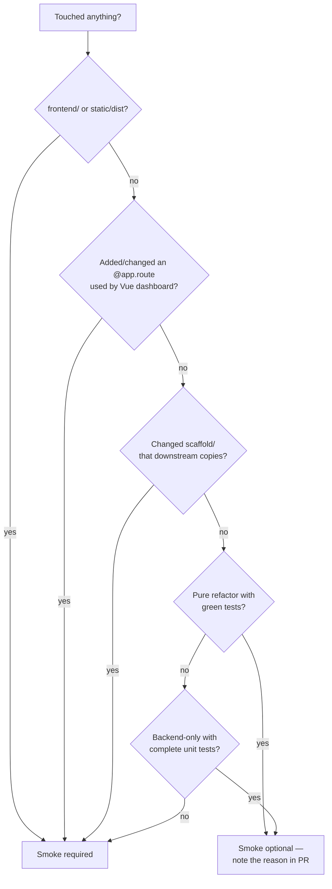

# Smoke Test Playbook

> **Why this exists:** CI checks that code compiles, types match, and unit
> tests pass. It does **not** prove the feature works in a browser. Most
> integration bugs (route 404, modal blocked by tutorial, API contract
> mismatch, CSS lint baseline regression, Vue SPA serving the wrong
> template) survive green CI and surface only when a human clicks.
>
> Smoke testing is the cheap insurance that closes that gap.

## When to smoke

| Tier | Examples | Smoke required? |
|---|---|---|
| **MUST** | UI changes (button, modal, layout, badge), new API + UI integration, cross-system flows (preflight gate, sync, redirect chain), scaffold updates that propagate to downstream projects | ✅ Always |
| **SHOULD** | Backend endpoint with a UI consumer, scheduler / SSE pipeline change, anything that demos in <5 min | ✅ Default yes — opt out with reason in PR description |
| **MAY skip** | Pure refactor with green tests, backend-only modules with thorough unit tests, docs / CHANGELOG / typo / config-only, bug fix covered by a regression test | ⚪ Optional |

If unsure: **smoke it**. The cost is 10 minutes; the cost of a regression in production is hours.

## How to smoke (without disrupting the running hub)

The hub instance you use day-to-day is on port 8080. Run your test on a
**separate free port** so you don't kill someone else's session.

```bash
# 1. Make sure your branch's frontend is built
cd frontend && npm run build && cd ..

# 2. Start a test server on 8081 (or any free port)
python -X utf8 app.py --port 8081 > /tmp/_hub_test.log 2>&1 &
echo $! > /tmp/_hub_test_pid

# 3. Open the v2 SPA — NOT the legacy template at /
# (Legacy /  is Jinja-rendered dashboard.html;
#  Vue SPA lives at /v2/<route>)
start http://localhost:8081/v2/dashboard

# 4. ... drive the UI manually OR via Playwright MCP ...

# 5. Stop the test server when done
# Note: $! gives the bash subshell PID — find the real Windows python PID:
powershell -Command "Stop-Process -Id (Get-NetTCPConnection -LocalPort 8081 -State Listen).OwningProcess -Force"
rm -f /tmp/_hub_test_pid /tmp/_hub_test.log
```

### Why `/v2/<route>` matters

`/` serves the **legacy vanilla-JS dashboard** (`templates/dashboard.html`).
The Vue v2 SPA — where new features live — is at **`/v2/<route>`**. Direct
navigation to `/projects` returns 404 because Flask doesn't have an SPA
catch-all on legacy paths. See `frontend/MIGRATION.md`.

## What to test

For every change, walk **two paths** at minimum:

1. **Happy path** — the main thing you're adding works
2. **Failure path** — at least one error/edge case behaves gracefully

Concrete scenarios for the surface area touched in v2.7.x:

### Drift badge (`/v2/projects`)

- [ ] Open `/v2/projects` — every project card shows `✓ in sync` (green) or `↻ N drift` (yellow when 1–2, red when ≥3)
- [ ] Hover the badge — tooltip shows breakdown ("X drifted, Y missing")
- [ ] Plant drift: rename `_mock-full/scripts/_preflight.py` → reload — badge should go up

### Sync now button

- [ ] Click "↻ Sync now" on a drifted project (`_mock-full` is the safe fixture)
- [ ] Confirm modal appears with title, description, two buttons
- [ ] Click "Sync now" in modal — toast `✓ Synced <name>` appears, badge count drops
- [ ] Verify on disk: `ls <project>/scripts/*.bak_synct_*` shows backups, new files have today's mtime
- [ ] Failure path: try syncing a project whose folder doesn't exist — should toast error, not crash

### Preflight gate (`/v2/pipeline`)

- [ ] With clean state, click any stage Run button — pipeline starts (no modal, preflight passed silently)
- [ ] Plant fake Excel lock: `touch <project>/input/~\$test.xlsx`
- [ ] Click Run again — modal "Preflight failed" appears, lists the locked file by name
- [ ] Click "ยกเลิก" (Cancel) — modal closes, pipeline does NOT start
- [ ] Click Run, click "รันต่อทั้งที่ยังเตือน" (override) — pipeline starts despite warning
- [ ] Cleanup: `rm <project>/input/~\$test.xlsx`

### Scaffold validator (CI + startup)

- [ ] Swap a known-bad template (e.g. `cr188/templates/...bak_v2_1_broken_*`) into `scaffold/full-pipeline/templates/Test_Result_Template.docx`
- [ ] Restart hub — startup log warns with the structural issues
- [ ] CI structure-check job fails with the same diagnostic
- [ ] Restore the good template, restart — clean

## Using Playwright MCP for ad-hoc smoke

Claude Code has Playwright MCP tools available. They drive a real browser,
take screenshots, and let you assert on accessibility snapshots. Good for
**one-off exploration** of a feature. Not a substitute for repeatable
Playwright tests checked into `tests/e2e/`.

Quick recipe for a smoke run via MCP:

```
1. mcp__playwright__browser_navigate to http://localhost:8081/v2/<route>
2. mcp__playwright__browser_snapshot — grab structure for assertions
3. mcp__playwright__browser_take_screenshot — visual evidence to attach to PR
4. mcp__playwright__browser_evaluate to click via JS when accessibility
   selectors are flaky (custom dropdowns, dynamically-mounted modals)
```

Common gotchas observed in this repo:

- `confirm({ message: ... })` is **not** the API — use `desc` (see `useConfirm.ts`)
- Custom CSS hex literals fail `lint:css` baseline — use existing vars (`--warn`, `--warn-soft`, `--danger`, `--danger-soft`)
- Project switcher in v2 isn't a `<select>` — set `localStorage('fp_project', '<id>')` and reload to switch programmatically
- Onboarding tutorial blocks the first interaction on a fresh session — click "ข้าม tutorial" or pre-set `localStorage('hub_onboarding_v1_seen', '1')`

## When to graduate ad-hoc → repeatable

Promote a smoke scenario into a checked-in Playwright test (`tests/e2e/<feature>.spec.ts`) when **any** of these are true:

- The flow is part of a release-blocking decision (release-gate, payment, auth, sync to a customer project)
- You've manually smoked the same scenario ≥3 times across PRs
- A regression in this flow has been shipped to production once

The first 3 candidates in this repo are **drift badge / sync flow / preflight gate** — covered manually in the v2.7.x merge but not yet in `tests/e2e/`.

## Decision shortcut


