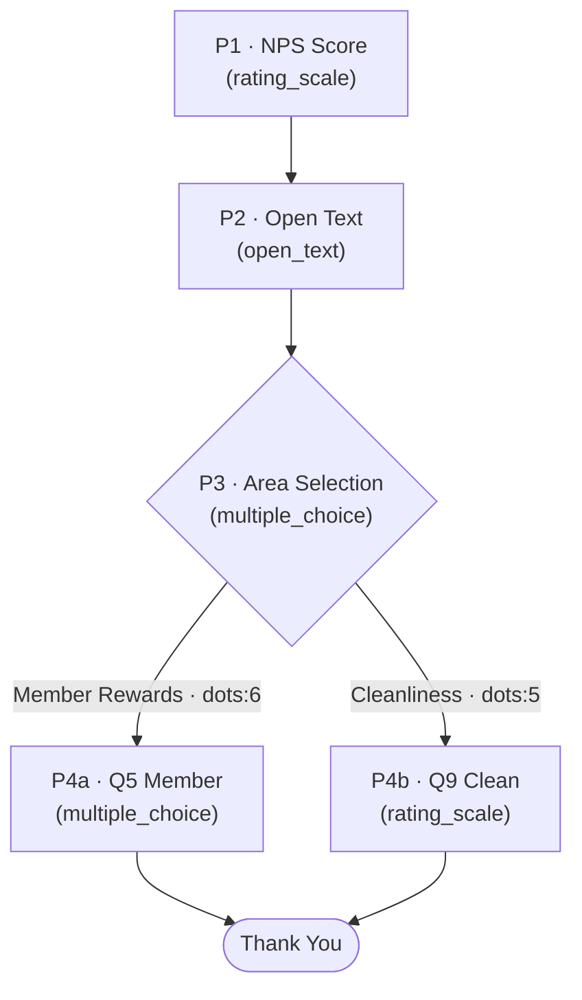

Explore all branch paths in a survey app using Playwright MCP, then save two output files:
- `requirements/survey_map.md` — raw path tree + exploration data
- `FLOW.md` — Mermaid flowchart + page details table (for BA Agent and team review)

**Usage:** `/explore <URL>`  
If no URL is given, read BASE_URL from CLAUDE.md.

Do NOT write any test code — report the complete map first, then wait for confirmation.

---

## Step 1 — Setup

Read BASE_URL or use $ARGUMENTS as the target URL.
Open the survey: `browser_navigate` to the URL.
Take an initial screenshot to confirm the page loaded.

---

## Step 2 — Per-page recording

On every page, use `browser_snapshot` to record:
```
pageId        : (from URL path, data attribute, or page title)
totalDots     : (progress indicator — total count)
activeDots    : (progress indicator — current position)
questionType  : (CSS class names on the question container)
questionText  : (visible question label)
choices       : (all available answer options if multiple_choice)
selectorHint  : (CSS class, data-*, or aria-label useful for Playwright)
```

---

## Step 3 — Branch exploration

For every `multiple_choice_one_answer` (or equivalent branching) page:

1. Note all available choices
2. For each choice (choice 1, 2, 3 ...):
   - Click the choice → click Next
   - Record: new pageId, totalDots, activeDots
   - Continue forward until end of path OR a page already seen
   - Navigate back (browser_navigate_back or reload) to try next choice
3. Mark each unique path found

**Depth limit:** max 30 pages per path to prevent infinite loops.  
**On timeout/error:** record the page as `[UNREACHABLE]` and continue.

---

## Step 4 — Build path tree

Construct a complete path tree, for example:
```
P1 (Q: NPS score)
└─ any score → P2 (Q: open text)
               └─ any text → P3 (Q: area selection)
                              ├─ Member Rewards → P4a → P5 → P6 → Confirm  [dots: 6]
                              ├─ Cleanliness    → P4b → P5 → Confirm        [dots: 5]
                              └─ Options        → P4c → P5 → P6 → Confirm  [dots: 6]
```

---

## Step 5 — Save File 1: `requirements/survey_map.md`

Write the raw exploration report (overwrite if exists) containing:

**A. All unique pageIds discovered** (sorted by discovery order)

**B. Question type per pageId**
| pageId | questionType | totalDots | choices | selectorHint |
|--------|-------------|-----------|---------|--------------|

**C. Branch differences between paths**
- pageIds that appear in some paths but not others
- totalDots that differ between paths

**D. Any question class not seen in the happy path**

**E. Full path tree** (text format as built in Step 4)

---

## Step 6 — Save File 2: `FLOW.md`

Write a structured flow document (overwrite if exists) with two sections:

### Section A — Mermaid flowchart

Generate a `flowchart TD` diagram where:
- Each node = one pageId with format: `ID["pageId · questionText\n(questionType)"]`
- Branch nodes use `{...}` shape
- Edges on branching pages are labeled with the choice text
- Terminal node = `END([Thank You / Confirm])`
- If totalDots differs between paths, annotate the edge: `-->|Choice A · dots:5|`

Example output:
````markdown

````

### Section B — Page details table

| pageId | questionText | questionType | totalDots | activeDots | choices | selectorHint |
|--------|-------------|-------------|-----------|------------|---------|--------------|
| P1 | NPS: How likely... | rating_scale | 3 | 1 | 0–10 | `.nps-rating` |
| P3 | Which area... | multiple_choice | 3 | 3 | A, B, C | `.area-card` |

Include all unique pages discovered across all paths.

---

## Step 7 — Archive + completion report

Write a timestamped archive copy to `docs/path_tree_YYYYMMDD.md` (same content as survey_map.md).

Then print:
```
✅ Exploration complete
   Pages discovered : X
   Unique paths     : Y
   Branch points    : Z
   Outputs saved:
     requirements/survey_map.md  (raw path tree)
     FLOW.md                     (Mermaid + page table)
     docs/path_tree_YYYYMMDD.md  (archive)

⏸ Waiting for confirmation before writing test files.
```
